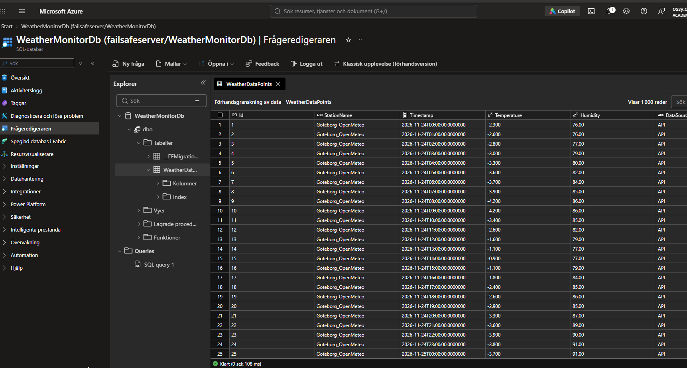

# FailSafe WeatherMonitor

Konsolapplikation som importerar vädermätningar från en CSV-fil och från Open-Meteo API till SQL Server med hjälp av EF Core.

## Lösningens struktur

| Projekt | Ansvar |
|---|---|
| `WeatherApp.Domain` | Entiteter, resultattyper och abstraktioner. |
| `WeatherApp.Infrastructure` | EF Core `DbContext`, migrationer och repositories. |
| `WeatherApp.Services` | Filimport, API-anrop, validering, loggning och statistik. |
| `WeatherApp.App` | Menyer och vyer med Spectre.Console. |

## Kom igång

1. Skapa databasen (se nedan).
2. Kör `WeatherApp.App`.

Den lokala anslutningssträngen (`(localdb)\MSSQLLocalDB`) finns i `WeatherApp.App/appsettings.json`.

## Databasmigrationer

```powershell
dotnet ef database update --project WeatherApp.Infrastructure --startup-project WeatherApp.App
```

## Molndatabas (Azure SQL)

Anslutningssträngen till Azure finns i `WeatherApp.App/appsettings.Production.json`. Den används när `DOTNET_ENVIRONMENT` är satt till `Production`:

```powershell
$env:DOTNET_ENVIRONMENT = "Production"
dotnet ef database update --project WeatherApp.Infrastructure --startup-project WeatherApp.App
dotnet run --project WeatherApp.App
```

### Bevis på migrering till Azure

Tabellerna (`WeatherDataPoints` och `__EFMigrationsHistory`) har migrerats med EF Core till Azure SQL-databasen `WeatherMonitorDb` på servern `failsafeserver`. Skärmdumpen nedan är tagen från frågeredigeraren i Azure-portalen och visar tabellen med data som hämtats från Open-Meteo API.


